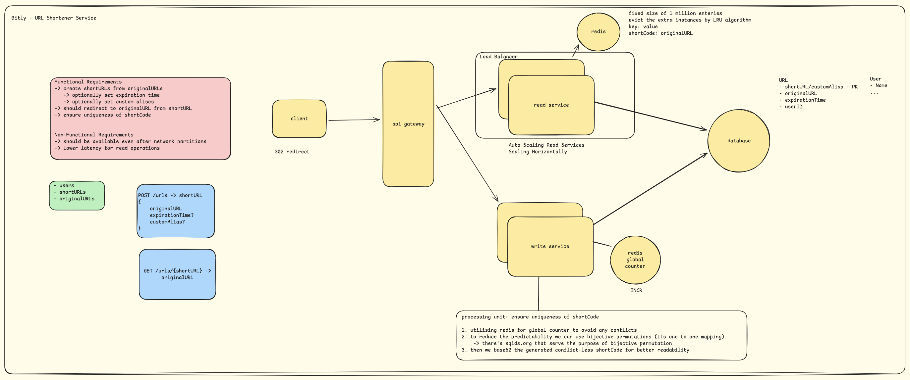

# Building a URL Shortener with Microservices, Redis, and Nginx

## Overview

I built a URL shortener using a microservices architecture, with separate services for creating and resolving short URLs.

The main idea was to keep the write operations separate from the read operations. Creating a short URL happens through one service, while resolving it is handled by multiple instances of another service.

I also introduced Redis for caching frequently requested URLs and generating unique short codes. Nginx acts as the API gateway and the single entry point for all incoming requests.

The application runs locally through Docker Compose and consists of the following components:

- **Nginx:** API gateway and load balancer.
- **Write Service:** Handles user creation and short URL generation.
- **Read Service:** Resolves short URLs. We run three instances of this service.
- **Redis:** Handles URL caching and generates unique integer IDs.
- **PostgreSQL:** Stores users and URL records.

## Architecture

The architecture separates URL creation from URL resolution.



All incoming requests first reach Nginx on port `80`. Based on the requested endpoint, Nginx forwards the request to the appropriate service.

Requests to create users or short URLs go to the write service. Requests to resolve short URLs are distributed across three read-service instances using Nginx's round-robin load balancing.

Each read-service instance uses the same Redis cache and PostgreSQL database.

This allows us to scale the read side independently without having to run additional instances of the write service.

### Services

| Service | Responsibility | Port |
|---|---|---|
| Nginx | API gateway and load balancer | 80 |
| Write Service | Creates users and short URLs | 8000 (internal) |
| Read Service (3 instances) | Resolves short URLs | 8001 (internal) |
| PostgreSQL | Persistent storage | 5432 (internal) |
| Redis | URL cache and atomic counter | 6379 (internal) |

PostgreSQL also exposes port `5434` on the host for local development.

### API Gateway with Nginx

I used Nginx as the single public entry point so clients don't need to know which service handles a particular operation.

It routes requests based on their paths:

- `POST /users` and `POST /urls` are forwarded to the write service.
- `GET /urls/{short_code}` is forwarded to the read service.

For URL resolution, Nginx distributes requests across the three read-service instances using round-robin load balancing.

This keeps the routing logic outside the application services and gives us the flexibility to add more read-service instances when needed.

---

## How It Works

### Creating a Short URL

When a user submits a URL, the write service generates a unique short code.

Instead of generating random strings and checking the database repeatedly to avoid collisions, I used Redis's atomic `INCR` operation to generate unique integer IDs.

The flow is:

1. The write service calls `INCR` on a Redis counter to get the next integer.
2. That integer is encoded into a short alphanumeric code using [Sqids](https://sqids.org).
3. The original URL, generated short code, and other relevant details are saved in PostgreSQL.

Using Redis `INCR` gives us an atomic counter, so concurrent requests receive different integer values.

Sqids handles converting these integers into shorter, more readable codes.

### Resolving a Short URL

URL resolution is expected to be the most frequently used operation, so I wanted to avoid hitting PostgreSQL on every request.

This is where Redis caching comes in.

Whenever someone accesses a short URL, Nginx forwards the request to one of the read-service instances. The service checks Redis first.

There are two possible outcomes.

**Cache hit:** If the short code exists in Redis, the service returns the cached result without querying PostgreSQL.

**Cache miss:** If the short code isn't in Redis, the service queries PostgreSQL. Once the record is found, it stores the result in Redis with a configured TTL (Time To Live) so future requests can be served from the cache.

This reduces repeated database queries for frequently accessed URLs.

### Custom Aliases

Users can also request their own custom aliases instead of relying on automatically generated short codes.

We handle two cases when checking whether an alias is already in use.

If the alias belongs to an active URL, the request is rejected with `409 Conflict`.

However, if the existing URL has already expired, we allow the alias to be reclaimed and assigned to the new URL.

This way, expired aliases don't remain unavailable forever.

### URL Expiration

Each URL can have an optional `expiration_time`.

We handle expiration at two different stages.

When creating a URL, we reject any expiration time that is already in the past with `422 Unprocessable Entity`.

When resolving a short URL, we check whether it has expired. Expired URLs return `410 Gone`, and their entries are removed from Redis when accessed.

This ensures that expired URLs are no longer served as valid links, including when they were previously cached.

---

## Redis Configuration

Redis serves two purposes in this application:

1. Generating unique integer IDs for short codes.
2. Caching URL records to reduce database queries.

Since the cache shouldn't consume unlimited memory, I configured Redis with a memory limit and an LFU eviction policy.

```yaml
redis-server --maxmemory 100mb --maxmemory-policy allkeys-lfu
```

The configuration has two important parts.

**100 MB memory limit:** Redis is restricted to a maximum memory allocation of 100 MB.

**LFU (Least Frequently Used) eviction:** When Redis reaches its memory limit, it evicts keys based on how frequently they are accessed. This helps keep frequently requested URLs in the cache while making room for less frequently used entries.

---

## Running Locally

The entire application can be started with Docker Compose:

```bash
docker compose up --build
```

Once the containers are running, all API requests go through Nginx:

`http://localhost`

### API Endpoints

**Users**

| Method | Endpoint | Description |
|---|---|---|
| POST | `/users` | Create a user |

**URLs**

| Method | Endpoint | Description |
|---|---|---|
| POST | `/urls` | Create a short URL |
| GET | `/urls/{short_code}` | Resolve a short URL |

**Health Checks**

| Method | Endpoint | Description |
|---|---|---|
| GET | `/health/write` | Write-service liveness |
| GET | `/health/read` | Read-service health check, including the instance that handled the request |

### Swagger Documentation

Each service exposes its own Swagger UI through Nginx:

| Service | URL |
|---|---|
| Write Service | `http://localhost/docs` |
| Read Service | `http://localhost/read/docs` |

---

## Conclusion

I built this project to see how separating reads from writes works in practice.

Splitting URL creation and URL resolution into separate services let me scale the read side on its own, with Nginx as the single entry point that routes requests and balances them across read-service instances.

Redis played two roles. Its atomic `INCR` counter, combined with Sqids, generates unique short codes without collision checks, and its cache, with a TTL and LFU eviction, keeps frequently accessed URLs away from PostgreSQL.

Together, these pieces gave me a clear, hands-on understanding of how read-heavy systems are structured and scaled.
